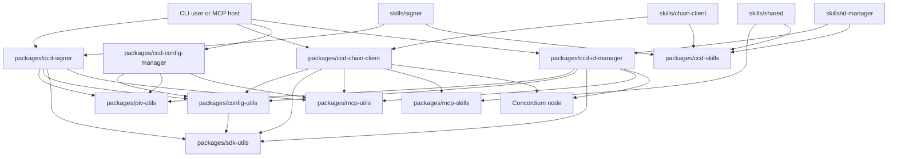
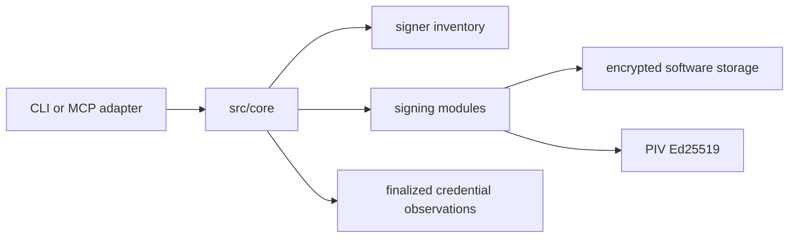
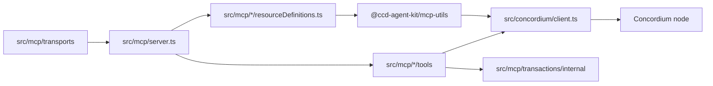
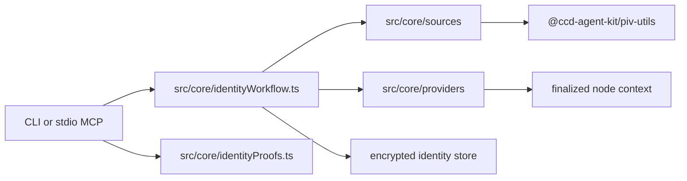

# Contributor Map

Navigation only. [Architecture](./architecture.md) defines boundaries and contracts;
[security](./security.md) defines trust and disclosure rules. Exported types, TSDoc,
MCP registrations, and CLI `--help` define callable details.

## Package Graph

Public tools never import each other. Signer alone owns account-signing keys; identity
manager owns identity secrets; chain MCP owns node access and explicit submission.

## Entrypoints

| Surface                | Start here                                                                            |
| ---------------------- | ------------------------------------------------------------------------------------- |
| `ccd-signer`           | `packages/ccd-signer/src/bin/ccd-signer.ts`, then `src/cli/`                          |
| `ccd-signer-mcp`       | `packages/ccd-signer/src/bin/ccd-signer-mcp.ts`, then `src/mcp/`                      |
| `ccd-chain-client-mcp` | `packages/ccd-chain-client/src/bin/ccd-chain-client-mcp.ts`, then `src/mcp/server.ts` |
| `ccd-config-manager`   | `packages/ccd-config-manager/src/bin/ccd-config-manager.ts`, then `src/cli/`          |
| Identity CLI/MCP       | `packages/ccd-id-manager/src/bin/`, then `src/cli/` or `src/mcp/server.ts`            |
| Shared config          | `packages/config-utils/src/index.ts`                                                  |
| Stateless codecs       | `packages/sdk-utils/src/index.ts`                                                     |
| Shared MCP lifecycle   | `packages/mcp-utils/src/index.ts`                                                     |
| PIV transport/codecs   | `packages/piv-utils/src/index.ts`                                                     |
| Skill source catalogs  | each owner under `src/**/assets/*/catalog.json`                                       |
| Public skill packaging | `packages/ccd-skills`                                                                 |

## Signer

Start in `src/core/sign/` for signing/finalization and `src/core/modules/` for runtime
capability policy. Catalog mutation, hardware management, and signer control-client
commands live in config/PIV while signer keeps backend execution, control-server
authentication, and runtime lock state. Canonical signing modules consume shared catalogs
directly; they need no provisioning-merge callback or duplicate lifecycle parser.
CLI/MCP adapters are thin. A PIV session exists only inside its awaited transport callback; do not
retain it or native handles.

## Chain Client

`src/concordium/client.ts` is the node-boundary import surface. Tool registrations are
under domain `tools/`; resource family definitions live with their domains. Each
network-dependent family defines one relative path and reader, then uses MCP-utils for its
default, explicit, and wildcard forms. Default and explicit failures are resource/JSON-RPC
errors; wildcard reads retain a result or sanitized error for every configured network.

The server captures its default network and process endpoint overrides at startup.
Omitted-network requests keep using that captured default; explicit non-default
networks use registry endpoints. Clients are cached without endpoint reload, so restart
the server after endpoint/default changes that an existing process must observe.

There is no WalletConnect/ID App pairing domain. Account opening uses the identity-manager
handoff, signer credential signatures, and chain client's standard
`complete_account_opening` completion/submission path.

Chain-client skill assets live under `src/mcp/skills/assets/chain-client`; server catalog code
outside that root reads its JSON catalog. Signer and identity manager use equivalent owned asset
roots. The shared network skill lives in `packages/mcp-skills/src/assets/shared`. Asset-root
`project.json` files define `skills/chain-client`, `skills/signer`, `skills/id-manager`, and
`skills/shared`; none is a package or versioned project. `packages/ccd-skills` discovers these source
catalogs directly and builds the seven-skill asset-only public package without importing server
output or native code.

## Identity Manager

Use `src/core/identityMaterial.ts` and `identityRoot.ts` for derivation, source runtime
for root trust, `providers/` for endpoint authority, and the encrypted store for identity,
credential, and reservation state. Monitor scheduling is ephemeral; workflow records,
attempt IDs, and reservations are durable truth.

Stored identity metadata has exactly two shapes. The issuance-lifecycle shape covers
`awaiting_verification | pending | error | expired` and may retain request, attempt,
authorization, retrieval, POST-session, and confirmed-failure fields. Completion binds the
returned identity before replacing that same entry with the `ready` issued shape, which
rejects all lifecycle fields. Production stores keep the identity object only in its
encrypted file; test/in-memory stores may attach the decrypted object to the issued shape.
Strict parsing of the issued shape requires a one-time internal metadata-only cleanup of
older ready entries, preserving their encrypted files; it adds no public migration command
or compatibility read path.

For configured POST issuance, the provider client sends the canonical CAIP-2 network and
stringified SDK request, accepts the human verification URL plus opaque context ID, and
derives the polling URL on the configured issuance origin. The workflow persists that URL;
status and monitor checks poll it for `pending | done | error`, while legacy records without
it continue through configured recovery GET. POST creation has no retry path.

Provider settings may independently configure AR identity IDs and an AR threshold for new
issuance. Configuration validates the merged policy against cached inventory. Request flow
revalidates it against the fresh finalized AR map before reservation or cryptographic work,
then passes the selected subset and resolved threshold to the SDK. The complete AR map stays
in `IdentityContext` for hashing, recovery, account credentials, and proofs; those existing-
identity paths do not enforce current issuance policy. A nonempty one-AR map is valid, but
new issuance on it requires explicit threshold `1`.

## Shared Config And CLI

Config owns XDG persistence, protected public catalogs, network resolution, shared label policy,
finalized public credentials, and identity-context snapshots. Its CLI is the sole
signing-key/identity-root/device provisioning, full label-management, signer
control-client, and persisted consumer module-policy management interface. The public
catalog trees are `signing-key` and `identity-root`; software storage and PIV hardware are
managed under `storage` and `device`. Account operations are grouped under `account`,
contract-instance labels under `contract-instance label`, and runtime/config consumers under
`service`. The old backend-first and flattened command paths are not aliases. Signer and
identity-manager runtimes consume and
enforce independent read-only policy from `@ccd-agent-kit/config-utils`; their CLIs do not manage
it. Status at the config CLI boundary is persisted policy only, not hardware or private-
material readiness. SDK-utils owns stateless validation/codecs; PIV owns shared hardware
mechanics.

Provisioning dispatch uses operator-facing `software|yubikey-piv` backend selectors, while
catalog ordering/location APIs use persisted `software-signer|yubikey-piv` IDs and software
storage uses encrypted-file only. Config-utils keeps the signer and identity-root
version-1 schemas separate. Small callback-driven permutation helpers enforce exact membership;
domain callbacks validate and compare locators. Software generation passes fresh cryptographic
seed bytes directly to protected storage and returns only public metadata. Forget operations
change public catalog custody metadata only.

All XDG helpers use the `ccd-agent-kit` application directory. MCP-utils constructs the
runtime-root registry path directly and is independent of config-utils; config-utils
consumes its generic instance client rather than reversing that dependency.

Chain settings are implemented by `packages/config-utils/src/chainClient.ts`; the
config-manager adapter is `packages/ccd-config-manager/src/cli/chainClientCommand.ts` and
registers the `chain-client` command group. The persisted filename is `chain-client.json`;
its schema and public config APIs are defined in `chainClient.ts`.

Credential handoffs keep their target prefix and use `credDeploymentHex` at public
boundaries. SDK-utils owns target-bound signature verification and reusable
`CredentialDeploymentInfo` assembly; chain MCP owns the separate account-opening envelope,
optional submission, and account-transaction completion tools.

All network-dependent resources flow through MCP-utils' injected network adapter and common
`{network, caip2, result}` envelope. Config-backed list/default/explicit resolution is a
synchronous snapshot; only the domain reader is asynchronous. Wildcards use
`{networks: {name: {network, caip2, result|error}}}`. MCP-utils' `registerMcpResources`
registers each `BoundMcpResourceDefinition` once with its typed metadata, reader, and optional
list/completion callbacks. Network families opt into subscription with `subscribable: true`;
eligible globals are listed explicitly.
`ResourceSubscriptionManager` stores exact URIs and pinned scopes; default and explicit
identity subscriptions pin one canonical network, while wildcard identity subscriptions pin
the configured-network set captured at subscribe time. Domain runtimes call
`manager.invalidate({ resourceName, network })` after a relevant runtime event. The manager keeps
only subscription state and performs no filesystem or registry observation.

Only signer `ccd://keys` runtime status and identity background-monitor terminal issuance
transitions publish updates. `bindResourceSubscriptions` installs schema-validated handling for
the signer and identity-manager stdio servers and composes with close handlers. Chain MCP
and HTTP do not advertise subscriptions; node-backed resources are request/response reads.

Instance-control production calls flow from `ccd-config-manager service signer|id-manager`
through `@ccd-agent-kit/config-utils` to the
MCP-utils client factory. Signer listing and software lock control retain their signer-specific
status parser. Covered successful config mutations use the shared config notifier to send
`inventory-refresh` or `sources-refresh` to the separate signer or identity-manager namespace.
Config CLI keeps MCP-utils as a development dependency only so its real-IPC test fixtures can
start generic control servers; production CLI code does not bypass the config client.

## Change Checklist

| Change                     | Primary location                                                             | Preserve                                                                                            |
| -------------------------- | ---------------------------------------------------------------------------- | --------------------------------------------------------------------------------------------------- |
| Label policy/persistence   | `packages/config-utils` plus catalog owner                                   | shared policy, native target equivalence, CAIP-2 scope, and XDG ownership                           |
| Signing runtime            | `packages/ccd-signer`                                                        | signer-only runtime use of account private keys                                                     |
| Consumer module policy     | `packages/ccd-config-manager`, `packages/config-utils`                       | consumer file formats and independent runtime enforcement                                           |
| Catalog/device mutation    | `packages/ccd-config-manager`, `packages/config-utils`, `packages/piv-utils` | config-only operator interface, explicit targeted device selection, and domain-owned private stores |
| MCP instance clients       | `packages/ccd-config-manager`, `packages/config-utils`, `packages/mcp-utils` | domain-owned servers, namespace separation, authentication, and protected IPC                       |
| Chain query/build behavior | `packages/ccd-chain-client`                                                  | JSON-safe DTOs and no signing                                                                       |
| Identity workflow          | `packages/ccd-id-manager`                                                    | identity-only custody and fail-closed pins                                                          |
| PIV transport              | `packages/piv-utils`                                                         | callback-scoped sessions and no policy ownership                                                    |
| Verification/release       | `scripts/`, `docs/development.md`, `docs/release.md`                         | shared local/CI entrypoints, five independent public tarballs, and pre-tag package validation       |
